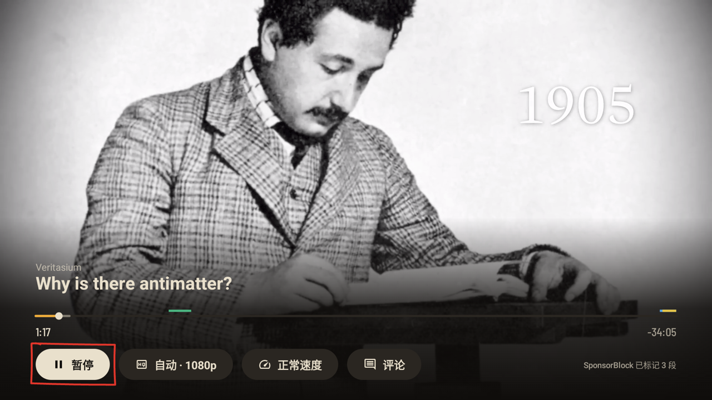
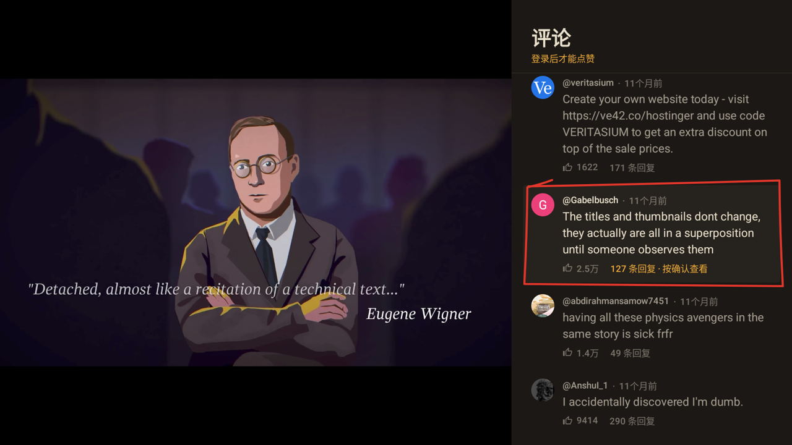

# OpenTube

[English](#english) · [简体中文](#简体中文)

| Home / 首页 | Player / 播放器 | Comments / 评论 |
|---|---|---|
|  |  |  |

---

## English

A YouTube client for Android TV. The backend comes from [SmartTube](https://github.com/yuliskov/SmartTube); the UI is rewritten from scratch in Jetpack Compose for TV.

SmartTube works and has no ads, but its interface is crowded, hard to use, and buried under settings. OpenTube keeps only what you need to watch videos, and treats "clicking a video and staring at a black screen" as the number one problem to solve.

> The UI is currently in Simplified Chinese only.

### Features

- **Home / Subscriptions / History / Search** in a left nav rail — moving focus onto a tab switches to it; search has suggestions
- **Fast start**: when focus rests on a video, OpenTube prefetches its stream info and quietly starts the stream in the background (a few seconds of buffer, no playback, no history entry). If you linger long enough, pressing OK plays almost instantly. A poster is shown instead of a black screen while loading
- **Auto quality**: adapts to bandwidth like the official app; you can also cap it
- **SponsorBlock**: skips sponsors, intros, outros and more, with segments marked on the timeline
- **No ads**
- **Comments**: open a side panel while the video keeps playing on the left; paging, replies, long-press OK to like
- **TV-code sign-in**: scan a QR code or enter a code at yt.be/activate — the app never sees your password

### Remote control

| Where | Keys |
|---|---|
| Browsing | D-pad to move, OK to play |
| Playing (controls hidden) | ← → seek 10 s, OK pause/resume, ↑ ↓ show controls |
| Controls | Pause · Quality · Speed · Comments |
| Comments panel | OK opens replies, long-press OK to like, Back closes one level |

### Install

Download the APK from [Releases](../../releases) and install it with `adb install` or any file manager on your TV/box.

### Build from source

Requires JDK 17 and the Android SDK (compileSdk 35).

```bash
./gradlew :app:assembleDebug
adb install -r app/build/outputs/apk/debug/app-debug.apk
```

### Project layout

```
app/                      OpenTube itself (Compose for TV)
  data/                   coroutine wrappers around the backend
  player/                 playback engine: prefetch, background preload, ABR, SABR recovery, SponsorBlock
  ui/                     screens and components
third_party/
  MediaServiceCore/       SmartTube's YouTube backend (MIT)
  SharedModules/          SmartTube's shared utilities (MIT)
  exoplayer/              SmartTube's ExoPlayer 2.10.6 fork with SABR support (Apache-2.0)
docs/                     backend integration notes, screenshots
DESIGN.md / PRODUCT.md    design system and product principles
```

`third_party/README.md` lists the upstream versions and every change OpenTube made to them.

### Known limitations

- YouTube's SABR streaming protocol makes the client wait about 4 seconds at the start of every playback session. This is enforced server-side; OpenTube hides it by preloading while you browse, but if you press OK right after focusing a video you may still wait 2–3 seconds.
- No channel page yet (selecting a channel searches for its name), no subtitles.

### Credits

The backend, playback core, and a huge amount of YouTube protocol work come from [yuliskov](https://github.com/yuliskov)'s SmartTube projects. This project would not exist without them.

### Disclaimer

This project is not affiliated with YouTube or Google. For personal and educational use only.

### License

OpenTube's own code is [MIT](LICENSE). Code under `third_party/` keeps its original license.

---

## 简体中文

一个给 Android TV 用的 YouTube 客户端：后端沿用 [SmartTube](https://github.com/yuliskov/SmartTube)，界面用 Jetpack Compose for TV 从头重写。

动机很简单：SmartTube 能用、没广告，但界面又挤又难用，设置多到找不到东西。OpenTube 只保留看视频真正需要的部分，并且把"点进视频要等很久黑屏"这件事当成头号问题来解决。

### 功能

- **首页 / 订阅 / 历史 / 搜索**：左侧导航栏，焦点移过去就切换；搜索带联想
- **快速起播**：焦点停在视频上，就预取播放信息并在后台悄悄开流（只缓冲几秒，不播放、不计入历史）。停留够久再按确认，基本点开即播；加载时显示封面，不黑屏
- **自动清晰度**：默认按带宽自适应（和官方 App 一样），也可以手动设上限
- **SponsorBlock**：自动跳过赞助、片头片尾等片段，时间线上标出位置
- **无广告**
- **评论**：播放时打开评论栏，视频让到左侧继续播；支持翻页、查看回复、长按点赞
- **电视码登录**：手机扫码或打开 yt.be/activate 输入代码，App 不接触密码
- 界面为简体中文

### 遥控器操作

| 场景 | 按键 |
|---|---|
| 浏览 | 方向键移动，确认播放 |
| 播放中（控制层收起） | ← → 快退/快进 10 秒，确认暂停/继续，↑ ↓ 调出控制层 |
| 控制层 | 暂停 · 清晰度 · 倍速 · 评论 |
| 评论栏 | 确认看回复，长按确认点赞，返回逐层收起 |

### 安装

从 [Releases](../../releases) 下载 APK，用 `adb install` 或任意文件管理器装到电视/盒子上。

### 从源码构建

需要 JDK 17 和 Android SDK（compileSdk 35）。

```bash
./gradlew :app:assembleDebug
adb install -r app/build/outputs/apk/debug/app-debug.apk
```

### 项目结构

```
app/                      OpenTube 本体（Compose for TV）
  data/                   后端的协程封装
  player/                 播放引擎：预取、后台预热、自适应码率、SABR 恢复、SponsorBlock
  ui/                     各页面与组件
third_party/
  MediaServiceCore/       SmartTube 的 YouTube 后端（MIT）
  SharedModules/          SmartTube 公共工具库（MIT）
  exoplayer/              SmartTube 维护的 ExoPlayer 2.10.6 分支，含 SABR 支持（Apache-2.0）
docs/                     后端接入笔记、截图
DESIGN.md / PRODUCT.md    设计系统与产品原则
```

`third_party/README.md` 记录了引入的上游版本和 OpenTube 做过的全部改动。

### 已知限制

- YouTube 的 SABR 视频协议在每次播放会话开始时，会要求客户端等待约 4 秒，这是服务器端的限制。OpenTube 用浏览时后台预热来消化这段等待，但焦点刚移到视频上就按确认，仍可能要等 2～3 秒。
- 还没有频道页（点频道会搜索频道名），没有字幕。

### 致谢

后端、播放核心和大量 YouTube 协议适配工作都来自 [yuliskov](https://github.com/yuliskov) 的 SmartTube 系列项目。没有它们就没有这个项目。

### 声明

本项目与 YouTube、Google 无关，仅供个人学习和使用。

### 许可证

OpenTube 自身代码采用 [MIT](LICENSE)。`third_party/` 下的代码保留各自原许可证。
