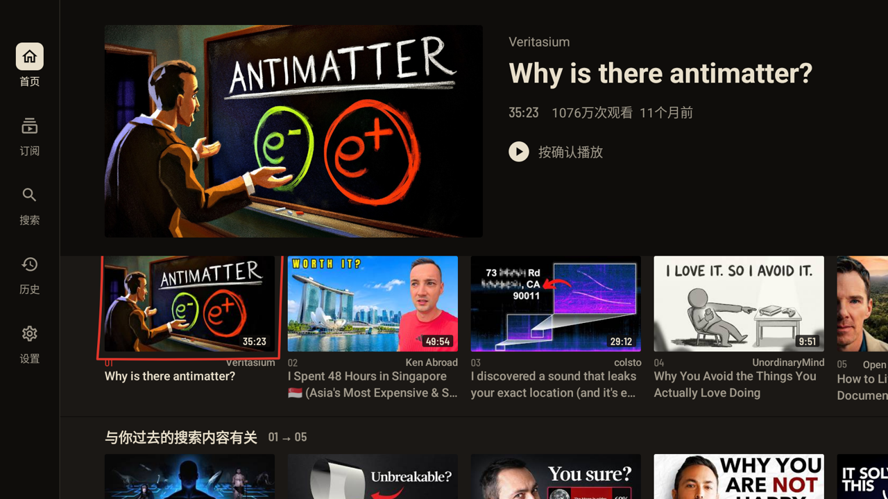

# OpenTube

一个给 Android TV 用的 YouTube 客户端：后端沿用 [SmartTube](https://github.com/yuliskov/SmartTube)，界面用 Jetpack Compose for TV 从头重写。

动机很简单：SmartTube 能用、没广告，但界面又挤又难用，设置多到找不到东西。OpenTube 只保留看视频真正需要的部分，并且把"点进视频要等很久黑屏"这件事当成头号问题来解决。

| 首页 | 播放器 | 评论 |
|---|---|---|
|  |  |  |

## 功能

- **首页 / 订阅 / 历史 / 搜索**：左侧导航栏，焦点移过去就切换；搜索带联想
- **快速起播**：焦点停在视频上就预取播放信息，预取命中时按确认约 1 秒内出画面；起播前显示封面，不黑屏
- **自动清晰度**：默认按带宽自适应（和官方 App 一样），也可以手动锁定上限
- **SponsorBlock**：自动跳过赞助、片头片尾等片段，时间线上标出位置
- **无广告**
- **评论**：播放时打开评论栏，视频让到左侧继续播；支持翻页、查看回复、长按点赞
- **电视码登录**：手机扫码或打开 yt.be/activate 输入代码，App 不接触密码
- 界面为简体中文

## 遥控器操作

| 场景 | 按键 |
|---|---|
| 浏览 | 方向键移动，确认播放 |
| 播放中（控制层收起） | ← → 快退/快进 10 秒，确认暂停/继续，↑ ↓ 调出控制层 |
| 控制层 | 暂停 · 清晰度 · 倍速 · 评论 |
| 评论栏 | 确认看回复，长按确认点赞，返回逐层收起 |

## 安装

从 [Releases](../../releases) 下载 APK，用 `adb install` 或任意文件管理器装到电视/盒子上。

## 从源码构建

需要 JDK 17 和 Android SDK（compileSdk 35）。

```bash
./gradlew :app:assembleDebug
adb install -r app/build/outputs/apk/debug/app-debug.apk
```

## 项目结构

```
app/                      OpenTube 本体（Compose for TV）
  data/                   后端的协程封装
  player/                 播放引擎：起播预取、自适应码率、SABR 恢复、SponsorBlock
  ui/                     各页面与组件
third_party/
  MediaServiceCore/       SmartTube 的 YouTube 后端（MIT）
  SharedModules/          SmartTube 公共工具库（MIT）
  exoplayer/              SmartTube 维护的 ExoPlayer 2.10.6 分支，含 SABR 支持（Apache-2.0）
docs/                     后端接入笔记、截图
DESIGN.md / PRODUCT.md    设计系统与产品原则
```

`third_party/README.md` 记录了引入的上游版本和 OpenTube 做过的改动。

## 致谢

后端、播放核心和大量 YouTube 协议适配工作都来自 [yuliskov](https://github.com/yuliskov) 的 SmartTube 系列项目。没有它们就没有这个项目。

## 声明

本项目与 YouTube、Google 无关，仅供个人学习和使用。

## 许可证

OpenTube 自身代码采用 [MIT](LICENSE)。`third_party/` 下的代码保留各自原许可证。
